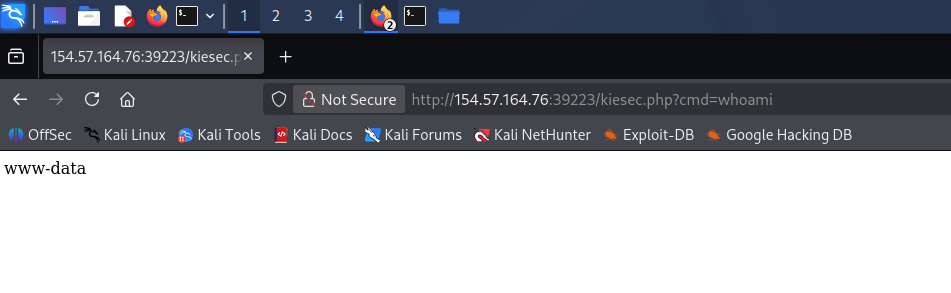
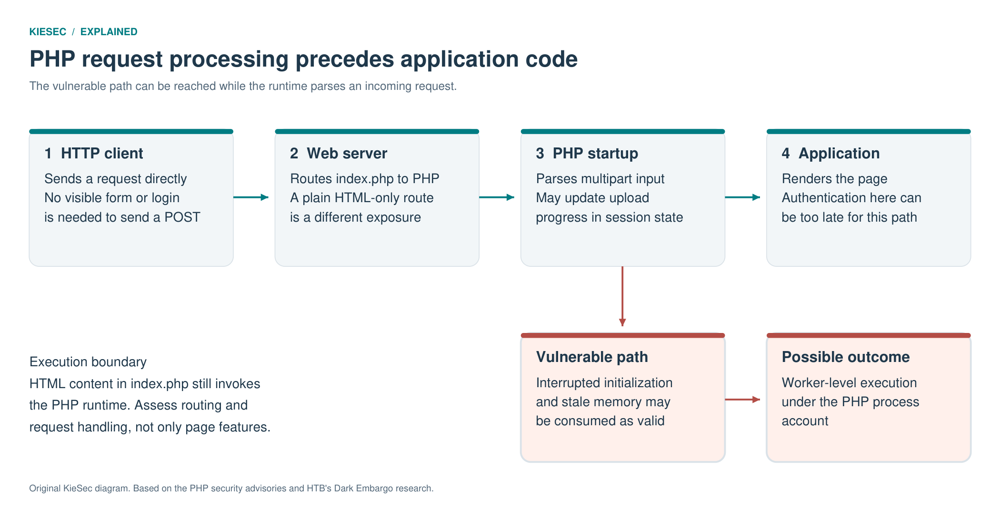
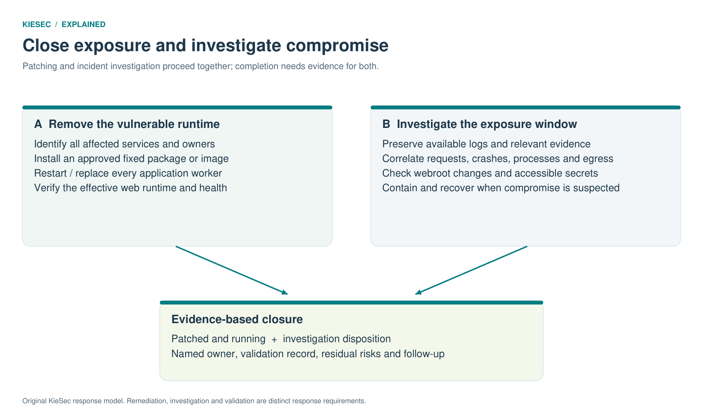

# PHP2Shell: Business Risk and Response Priorities

**An attacker-and-defender case study for business owners, executives, and service managers**

**Author:** Kiemar Lopes · KieSec  
**Lab work completed:** 1 November 2026  
**Exercises:** Hack The Box Dark Embargo and dOOMs Day  
**Vulnerabilities:** CVE-2026-109618 and CVE-2026-109619

[Technical report and evidence](README.md) · [Download the stakeholder PDF](pdf/PHP2Shell_Stakeholder_Brief.pdf)

## Executive Summary

I reproduced PHP2Shell against an authorized lab website, verified command execution as its web-service account, examined the resulting files, and retrieved the challenge flag. I also completed the accompanying dOOMs Day defender investigation to study how the exploitation and subsequent activity can be reconstructed from web logs and network evidence. Both exercises were completed on 1 November 2026. ([E05](assets/figures/user-whoami.png); [E08](assets/figures/user-doomsday-completion.png); [E09](assets/figures/user-dark-embargo-completion.png))

This work began with a deceptively simple question: **how can a website without a login or visible forms expose its server to remote code execution?** The answer lies in the software underneath the page. PHP2Shell exploits faults in PHP's handling of memory and request state. In the demonstrated Apache configuration, the vulnerable processing can happen before the application page runs. ([5](#ref-5), [6](#ref-6), [7](#ref-7), [1](#ref-1))

The business lesson is practical: assess the complete service, including its runtime, configuration, permissions, and network access. A maintenance page or simple website does not establish that the underlying service is safe.

**Recommended decision:** identify affected services, assign accountable owners, apply current security updates, restart or replace affected running instances, and investigate possible earlier compromise in parallel. Temporary restrictions should have an owner and an expiry; completing the patch does not by itself complete an incident investigation.

## 1. My Work: From Exploitation to Investigation

I attended HTB's **Inside the PHP2Shell Exploit** virtual seminar, studied the vulnerability research and TheCyberGeek's proof-of-concept implementation, and applied that work in my own testing. My Kali terminal captures, response-header checks, Wappalyzer identification, website observations, and execution screenshots record that practical work. ([1](#ref-1); [3](#ref-3); [4](#ref-4); [E04](assets/figures/user-exploit-console.png))

| Work performed | What I verified | Business significance |
| --- | --- | --- |
| Inspected the website and response headers, supported by Wappalyzer. | The brochure-style page advertised PHP 8.4.26 and Apache. | The technology serving a page is relevant even when the visible content appears simple. |
| Ran TheCyberGeek's Python proof of concept in the authorized attack lab. | The captured run reported worker saturation, a memory leak, and execution attempts. | A flaw below the application can create a route to server-side execution. |
| Checked the result through a subsequent request. | The command returned `www-data`, the web-service account. | The attack reached the server's execution context; the result was verified beyond the tool's status messages. |
| Examined directory contents and retrieved the lab flag. | The listing showed the additional PHP file, and the challenge resource was readable. | File permissions and writable application directories help determine the consequences of an initial compromise. |
| Completed dOOMs Day from the defender perspective. | Worked through the investigation of request patterns, memory errors, leaked data, and subsequent shell activity. | Response requires connecting evidence across sources, not relying on one alert. |

*Figure 1. My live testing screenshot: the verification request returned `www-data`. The companion technical report includes my terminal run, reconnaissance, directory listing, and completion evidence. ([E05](assets/figures/user-whoami.png))*

Dark Embargo provided the attack exercise; dOOMs Day provided a separate defender dataset. My completion records show both exercises as **Retired**. The technical report includes those records and credits HTB's published diagrams and defender screenshots where reproduced.

## 2. Why a Simple Page Can Expose a Complex Service

A browser displays the finished response. Before that response is produced, the server may parse request headers, process uploaded data, and initialize sessions. These operations can occur even when the page offers no upload form or login.

The Dark Embargo page contains static HTML but is delivered through a PHP-enabled server. PHP's upload-progress handling creates a path into vulnerable runtime behavior before application code needs to do anything. An attacker can construct requests directly; the buttons displayed by the website do not define everything the server will accept. ([1](#ref-1))

*Figure 2. Original explanatory diagram. The web runtime processes a request before returning the visible page.*

At a high level, the demonstrated chain keeps most web workers busy, directs related requests toward the remaining worker, exposes a region of its working memory, and uses corrupted state to reach command execution. The weakness resides in the platform beneath the website, so removing interactive features does not repair it.

A site served entirely as static files without PHP processing has a different exposure. The right question is therefore: **which software actually receives and processes requests for this service?** Answering it requires an inventory and deployment evidence, not a judgment based on appearance.

## 3. Business Consequences Depend on Access

PHP2Shell can enable unauthenticated remote code execution. PHP identified Apache with `mod_php` as the highest-risk demonstrated configuration, while advising other PHP web deployments to assess and update as well. ([5](#ref-5), [6](#ref-6), [7](#ref-7))

The initial access in my attack lab ran as the web-service account. That account's permissions determine what an attacker could do next. A restricted account can still read application configuration, modify writable content, or reach a database. Network separation and least privilege reduce those opportunities.

| Business concern | Potential consequence | Question for the owner |
| --- | --- | --- |
| Confidentiality | Access to readable business data, configuration files, or application secrets. | What sensitive information and credentials can this service account read? |
| Integrity and trust | Modified website content or an additional executable file that enables later access. | Can the web process write into locations that execute code? |
| Availability | Exhausted workers, failed requests, slow service, or crashes during attempted exploitation. | Which customer or operational processes depend on this service? |
| Wider access | Attempts to reuse credentials or network connections to reach other systems. | Which internal services, databases, and cloud permissions are available? |
| Recovery cost | Investigation, service restoration, credential changes, and validation of trusted systems. | Do we have the evidence, backups, and people required to recover confidently? |

Actual business impact depends on the organization's data, permissions, connectivity, and exposure.

## 4. Response Priorities and Ownership

An effective response has two workstreams: reduce the opportunity for further exploitation, and determine whether access already occurred. Waiting for one to finish before starting the other can leave either exposure or uncertainty unresolved.

*Figure 3. Original KieSec response model: remediation closes the entry point while investigation establishes what happened.*

The priorities below are recommendations, not regulatory deadlines. Apply them through the organization's emergency-change and incident-response processes.

| Priority | Required action | Accountable role | Evidence to request |
| --- | --- | --- | --- |
| Identify exposure immediately | Inventory PHP services, including containers, managed hosting, older applications, and bundled products. Prioritize exposed services and the demonstrated Apache configuration. | Infrastructure and application owners | Owner, business purpose, exposure, runtime, package source, and support status for each service. |
| Investigate in parallel | Preserve relevant records and examine unusual requests, worker failures, executable files, process activity, and outbound connections. | Security or incident-response lead | A timeline, supported findings, collection gaps, and follow-up actions. |
| Make an urgent controlled change | Apply current security updates, restart or replace affected running instances, and verify application function. | Platform owner and change manager | Deployment evidence, running-runtime checks, restart records, and functional results. |
| Manage delayed remediation | Restrict exposure or suspend the service where justified. Evaluate temporary controls and their availability effects. | Business owner with security and operations | A documented exception, compensating measures, accountable owner, and expiry or review time. |
| Validate recovery and close | Confirm that fixes are active and that any evidence of compromise has been addressed. | Incident lead and business owner | A clear closure decision with residual risks and remaining actions. |

**Update what is actually running.** Updating a content-management system alone may leave PHP unchanged. Updating a container's base image alone does not replace containers already running from the old image. Managed services and appliances require confirmation from the responsible vendor or provider.

For the original vulnerability pair, the minimum fixed branch releases were **PHP 8.2.35, 8.3.36, 8.4.27, and 8.5.12**. These are historical minimums for those two CVEs. Engineers should deploy the current supported security update for the platform and verify vendor-backported fixes where applicable. ([5](#ref-5), [6](#ref-6), [7](#ref-7))

PHP's 23 October follow-up notice addresses an additional, unusual configuration-dependent route, CVE-2026-115560. The team should review that notice and retain its recommended upload-progress restriction where applicable until the corresponding fix is deployed. Remediation must account for subsequent advisories as well as the original pair. ([8](#ref-8))

For older PHP branches, request a supported migration or vendor-fix plan. Limited source backports were supplied for some end-of-life releases in this exceptional case; they did not restore those branches to general support. ([5](#ref-5))

Temporary configuration changes need engineering review. Some reduce one exploitation path by removing a resource limit, which can increase availability risk. They should not become an indefinite substitute for a supported update. Hiding error messages does not repair the vulnerable memory handling. ([5](#ref-5), [6](#ref-6), [7](#ref-7))

## 5. Questions That Turn an Update into a Defensible Decision

Business owners do not need to interpret memory addresses. They do need clear answers from the teams responsible for the service:

- **Coverage:** Have we identified every affected instance, including replicas, containers, and vendor-managed systems?
- **Execution:** Is the fixed runtime running, and have the relevant workers been restarted or replaced?
- **Service health:** Did representative business transactions pass after the change?
- **Earlier access:** What period was investigated, which evidence was available, and what was found?
- **Recovery:** Were unexpected files, exposed credentials, or other compromise indicators addressed where required?
- **Residual risk:** Which exceptions, evidence gaps, or unfinished actions remain, and who owns them?

A clean log search does not prove that no compromise occurred. Detailed request data may never have been collected, records may have expired, or monitoring may cover only part of the service. Investigators should explain those limits in their conclusion.

If a system must be restored, the recovery plan should use trusted code, appropriate credential changes, and validated configuration. A rollback plan should also avoid quietly restoring the vulnerable version. Where safe remediation cannot be completed, the service owner should make an explicit, documented exposure decision.

## 6. Scope, Next Validation, and Acknowledgements

My completed work covers attack reproduction, verification, and a separate defender investigation. The results demonstrate lab execution as the web-service account and access to the challenge resource. They do not establish a production breach or administrator control. A controlled post-patch comparison remains a next validation step.

TheCyberGeek's research, Python proof of concept, and HTB seminar supported my practical reproduction. HTB's **Dark Embargo** write-up and CyberJunkie's **dOOMs day** write-up support the explanations and selected third-party figures. Original vulnerability discovery is credited to Calif, OpenAI, and Wiz. ([1](#ref-1), [2](#ref-2), [13](#ref-13))

My contribution is the practical lab work, live-test evidence, and interpretation for technical and business audiences. AI assistance supported editing, source cross-checking, explanatory diagrams, and document production.

## Sources and Evidence

Reference numbers are shared with the technical report.

**1.** Hack The Box, **Dark Embargo**, TheCyberGeek, 24 October 2026; [research repository and proof of concept](https://github.com/TheCyberGeek/php2shell-research).

**2.** Hack The Box, **dOOMs day Writeup**, CyberJunkie, 29 October 2026.

**3.** Hack The Box, **Inside the PHP2Shell Exploit**, virtual seminar attended by Kiemar Lopes. Workshop screenshots are credited to HTB.

**4.** TheCyberGeek, [php2shell-research](https://github.com/TheCyberGeek/php2shell-research). [Phase D implementation directory](https://github.com/TheCyberGeek/php2shell-research/tree/main/D_oom_mod_php). The attacker write-up links [exploit.py](https://raw.githubusercontent.com/TheCyberGeek/php2shell-research/refs/heads/main/D_oom_mod_php/exploit.py).

**5.** PHP Project, [21 October 2026 security announcement](https://www.php.net/archive/2026.php).

**6.** PHP Project, [CVE-2026-109618 advisory](https://github.com/php/php-src/security/advisories/GHSA-w8hw-w9fx-j79w).

**7.** PHP Project, [CVE-2026-109619 advisory](https://github.com/php/php-src/security/advisories/GHSA-6wmf-4rv5-p3rp).

**8.** PHP Project, [23 October 2026 follow-up notice](https://www.php.net/archive/2026.php), concerning CVE-2026-115560.

**13.** Calif Research, [PHP2Shell original disclosure](https://calif.io/php2shell/).

**Evidence index:** Kiemar Lopes, live-test screenshots and completion records for both exercises. See the [evidence register](evidence-register.csv) and [technical report](README.md).

Selected HTB material remains attributed to its creators. The original HTB PDFs and raw flag capture are not redistributed in this package.
